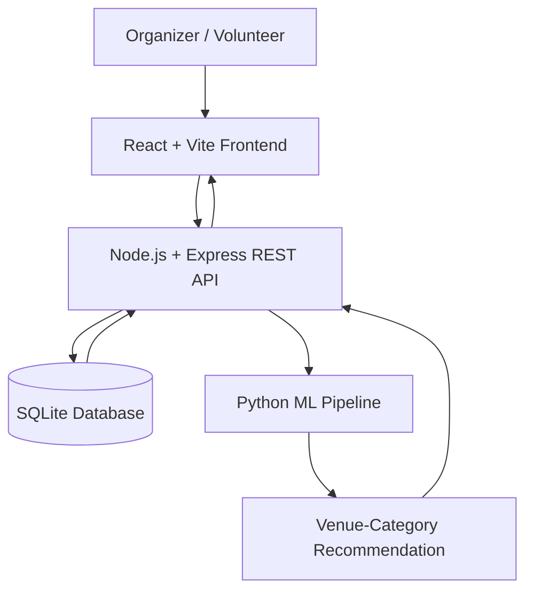

<div align="center">
  

  <h3>Smart Event Planning, Management & Analytics</h3>
  <p><strong>Planning se payment tak, sab sorted!</strong></p>
  <p>Plan smarter · Coordinate teams · Track costs · Learn from every event</p>
</div>

---

## 🌟 Overview

**EventWala** is an event planning, management, and analytics platform designed to help organizers coordinate an event from initial planning through execution and post-event reporting.

It brings event details, planning calculations, venue scoring, volunteer coordination, task management, resource allocation, budgets, attendance records, and reports into one workflow. Instead of relying entirely on manual coordination, organizers can use transparent rules, saved records, and a venue-category machine-learning model to support decisions.

### The platform helps teams manage

- 🗓️ Event details, schedules, and milestones
- 💰 Budget estimates, expenses, and payment records
- 📍 Venue shortlisting and venue-category recommendations
- 🙋 Volunteer estimates, assignments, and performance information
- ✅ Task assignments, due dates, completion, and review
- 📦 Resource quantities, allocation, issue, acknowledgement, and return
- 🎟️ Participant registration and QR ticket/check-in workflows, where available in the current build
- 📊 Event readiness, analytics, archived reports, and exports

> **Product tagline:** *Planning se payment tak, sab sorted!*

## 🎯 Problem Statement and Objectives

Planning an event means coordinating multiple activities at once: venue selection, budget preparation, staffing, volunteers, resources, registrations, schedules, attendance, expenses, and final reporting. Managing these independently can lead to missed tasks, unclear costs, and incomplete records.

EventWala aims to centralize the planning and coordination process and provide **calculation-based decision support** for event teams.

### Main objectives

- Plan events in a structured workflow.
- Estimate budgets using configured formulas and category assumptions.
- Score candidate venues using event requirements, capacity, and cost.
- Recommend a venue category using a trained classification model.
- Estimate volunteer roles using configured participant ratios.
- Compare requested resource quantities with saved allocations.
- Generate and manage event timelines.
- Prioritize tasks using configured factors and fuzzy/weighted rules.
- Coordinate volunteers and task completion.
- Record income, expenses, allowances, and payments.
- Track registrations and recorded attendance where supported.
- Analyze event performance and produce final reports.

## 🚀 At a Glance

| Area | What it covers |
|---|---|
| Event management | Create, edit, view, publish, monitor, and complete events |
| Planning assistance | Cost estimates, venue scoring, volunteer ratios, and timelines |
| Venue ML | Random Forest venue-category classifier |
| Task management | Assignment, status, deadlines, completion submissions, and review |
| Resource management | Inventory, allocation, usage, and quantity-gap checks |
| Finance | Budgets, transactions, expenses, allowances, and payment status |
| Event monitoring | Readiness indicators, progress, attendance records, and alerts |
| Reporting | Event, budget, attendance, volunteer, resource, and task reports; PDF/CSV exports where available |

## 👥 User Roles and Access

The current intended application workflow focuses on **Organizer** and **Volunteer** experiences. Attendee registration/ticketing can be an event workflow without requiring a separate attendee login. Keep role visibility aligned with the actual routes and permissions in the codebase.

### Organizer

Organizers coordinate the events they are authorized to manage. Depending on the feature enabled in the current build, their workspace covers:

- Creating and managing events
- Running planning tools and reviewing cost estimates
- Managing volunteers and assignments
- Creating tasks and reviewing volunteer submissions
- Managing resources and allocation records
- Tracking budgets, expenses, allowances, and payments
- Monitoring progress and readiness
- Reviewing performance and generating reports

### Volunteer

Volunteers use a personal workspace to:

- View their assigned events and tasks
- Review instructions and deadlines
- Update permitted task statuses
- Submit task completion notes/proof and view feedback, if enabled
- View their own performance information
- View their own allowance/payment information, if enabled
- View resources assigned to them and use permitted issue/return actions
- Receive notifications and manage profile information

> **Access-control reminder:** The frontend navigation should match server-side permissions. Hiding a button alone is not authorization.

## 🔄 Complete Event Workflow

```mermaid
START
  |
  v
Admin / Event Manager Login
  |
  v
Central Dashboard

  |
  v
Create New Event
  |
  +--> Enter Event Details
  |      - Event Name
  |      - Client / Organization
  |      - Event Type
  |      - Date and Location
  |      - Duration
  |      - Expected Attendance
  |      - Expected Income
  |      - Initial Budget Limit
  |
  v
AI-Based Event Cost Estimation
  |
  +--> Venue Cost Estimation
  +--> Food and Beverage Cost Estimation
  +--> Decoration Cost Estimation
  +--> Equipment Cost Estimation
  +--> Transportation Cost Estimation
  +--> Staff and Volunteer Cost Estimation
  +--> Marketing and Miscellaneous Cost Estimation
  |
  v
Calculate Total Predicted Expenses
  |
  v
Calculate Projected Profit / Loss
  |
  v
Review and Approve Estimated Budget
  |
  v
Save Event and Budget Baseline
  |
  v
Event Execution Begins
  |
  +--> Record Income and Client Payments
  |
  +--> Record Expenses and Vendor Payments
  |
  +--> Track Pending Receivables and Payables
  |
  +--> Assign Volunteers and Roles
  |
  +--> Record Volunteer Attendance
  |
  +--> Assign and Track Tasks
  |
  +--> Record Task Completion and Supervisor Feedback
  |
  v
Monitor Financial and Operational Performance
  |
  +--> Compare Predicted Expenses with Actual Expenses
  |
  +--> Calculate Budget Variance
  |
  +--> Calculate Actual Profit / Loss
  |
  +--> Calculate Cash Position
  |
  +--> Calculate Volunteer Attendance Rate
  |
  +--> Calculate Task Completion Rate
  |
  v
Event Completed
  |
  v
Review Event Information
  |
  +--> Verify Income and Expenses
  +--> Verify Volunteer Records
  +--> Review Task Completion
  +--> Record Final Attendance Count, If Available
  +--> Record Client / Organizer Satisfaction
  |
  v
Fuzzy Logic-Based Event Performance Evaluation
  |
  +--> Budget Control
  +--> Volunteer Reliability
  +--> Task Completion
  +--> Client / Organizer Satisfaction
  |
  v
Determine Operational Performance
  |
  +--> Excellent
  +--> Good
  +--> Average
  +--> Needs Improvement
  |
  v
Generate Final Post-Event Report
  |
  +--> Event Summary
  +--> Predicted vs Actual Expenses
  +--> Income and Profit / Loss
  +--> Budget Variance
  +--> Payments Received and Made
  +--> Outstanding Receivables and Payables
  +--> Volunteer Performance
  +--> Task Completion Statistics
  +--> Event Performance Evaluation
  +--> Recommendations for Future Events
  |
  v
Download Report as PDF / Export Financial Data as CSV
  |
  v
Save Report in Event Archive
  |
  v
View, Search, and Download Archived Reports
  |
  v
END
```

---

# ✨ Features

## 1. Event Creation and Management

Organizers can create and maintain event records. Typical event inputs documented by the project include:

- Event name and type
- Date, start time, end time, and duration
- Venue/location and description
- Expected participant count
- Planned budget

Supported event categories in the supplied project documentation include conferences, concerts, weddings, workshops, festivals, competitions, seminars, sports events, college events, and corporate events.

Common event lifecycle labels include **Draft, Upcoming, Ongoing, Completed, and Cancelled**; the values shown by the UI depend on the current implementation.

## 2. Budget Estimation

The budget estimator produces an illustrative estimate from event inputs and configured category cost assumptions. Inputs can include:

- Event type
- Expected participants
- Event duration
- Venue style
- Configured category cost factors

The documented breakdown includes:

- Venue
- Food and refreshments
- Staffing
- Technology
- Marketing
- Logistics
- Contingency

Example input:

```text
Participants: 1,200
Duration: 1 day
Event type: College event

Output: An illustrative estimate calculated from the event inputs
```

The estimate is calculated with a deterministic formula. It is **not a trained regression model** and does not provide validated statistical confidence.

## 3. Venue Recommendation Engine

The project documentation describes two complementary approaches.

### A. Rule-based venue shortlisting

Scores specific candidate venues using inputs such as:

- Expected participants
- Budget
- Event type
- Candidate venue capacity
- Candidate venue cost

The shortlist can display capacity, cost, and a fit score from 0 to 100% for comparison.

### B. Machine-learning venue-category recommender

The separate Python model predicts a venue **category**, rather than choosing a guaranteed real-world venue.

| Item | Documented configuration |
|---|---|
| Model | `ColumnTransformer` + `RandomForestClassifier` pipeline |
| Framework | Python, scikit-learn, joblib |
| Reported test accuracy | 90.83% |
| Weighted F1-score | 90.83% |
| Reported precision | 91.05% |
| Reported recall | 90.83% |
| Dataset | 1,200 samples; 960 training / 240 test, stratified split |
| Model artifact | `backend/ml/model.pkl` |
| Metrics | `backend/ml/metrics.json` |
| Detailed report | [`MODEL_INFO.md`](MODEL_INFO.md) |

**Input features** documented for the model:

- `event_type`
- `city`
- `budget` in INR
- `guest_count`
- `budget_per_guest` (derived from budget / guest count)

The documented city set includes Mumbai, Delhi, Bengaluru, Hyderabad, Chennai, Kolkata, Pune, Ahmedabad, Jaipur, Lucknow, Chandigarh, and Goa. Event-type labels documented for the model include Wedding, Birthday, Corporate, Anniversary, and Engagement.

**Target venue categories and reported per-class F1 scores:**

| Venue category | Reported F1-score |
|---|---:|
| Budget Banquet | 94.38% |
| Community Hall | 92.31% |
| Conference Hall | 88.89% |
| Luxury Hotel | 87.32% |
| Outdoor Garden | 85.71% |
| Premium Banquet | 87.64% |

CLI example:

```bash
python backend/ml/predict.py '{"event_type":"Wedding","budget":300000,"guest_count":250,"city":"Mumbai"}'
# Example output: Budget Banquet
```

The example is illustrative. Verify `MODEL_INFO.md` and the current model files for the latest evaluation details and supported inputs.

## 4. Volunteer Estimates and Management

Volunteer estimates use configured role ratios based on event type and participant count. Documented roles include:

- Registration
- Crowd management
- Technical support
- Hospitality
- Logistics

Illustrative calculation output for 1,200 participants at a conference:

```text
Registration:       24
Crowd management:   12
Technical:           6
Hospitality:         8
Estimated total:    50
```

These are formula outputs—not historical staffing results or guaranteed requirements. Actual staffing gaps should be assessed from saved volunteer assignments.

Volunteer records may include name, email, skills, availability, assigned tasks, completed tasks, and performance. Documented availability labels include **Available, Busy, and Unavailable**.

## 5. Resource Management and Allocation Gap Checks

Organizers can maintain resource inventory and event allocations. Example resource types include chairs, tables, projectors, microphones, speakers, laptops, banners, and certificates.

The allocation review compares requested quantities with saved allocated quantities. It **does not forecast resource needs with an AI model**.

```text
Resource: Chairs
Requested: 1,100
Allocated:   950
Remaining:   150
```

The resource table may display resource name, category, event ID, requested quantity, allocated quantity, and status. The remaining amount is calculated as:

```text
remaining = max(0, requested - allocated)
```

Missing or invalid quantities should be flagged instead of being presented as predictions. Resource states documented by the project include **Available, Reserved, In Use, and Unavailable**. Where supported, the workflow also tracks issue, acknowledgement, usage, return, and inventory updates.

## 6. Event Timeline and Fuzzy Task Prioritization

### Event timeline

The timeline can use event duration, activities, event type, start time, and end time. Organizers can add, edit, or delete activities and adjust timings.

Example schedule:

| Time | Activity |
|---|---|
| 08:00 AM | Registration |
| 09:00 AM | Opening ceremony |
| 09:30 AM | Keynote |
| 11:00 AM | Workshop |
| 01:00 PM | Lunch |
| 02:00 PM | Competition |
| 04:30 PM | Results |
| 05:00 PM | Prize distribution |

### Task management

Task records may include title, description, deadline, priority, assigned volunteer, category, and status. Documented status examples include Pending, In Progress, Completed, and Overdue; the current application may use additional review states.

### Fuzzy/weighted task prioritization

The documented priority logic considers factors such as:

- Deadline urgency
- Task importance
- Budget impact
- Participant impact

Priority classes include **Low, Medium, High, and Very High**. For example, a task close to its deadline with high participant impact may receive a high priority.

Illustrative output from the supplied baseline documentation:

```text
Priority score: 91/100
Priority: VERY HIGH
Reason: Near deadline + high participant impact
```

Any displayed score should be based on the current calculation and saved input values—not fabricated confidence.

## 7. Participant Registration, Tickets, and Attendance

The supplied project documentation includes registration and QR ticket/attendance workflows. Keep this feature description aligned with the actual build and avoid implying that a separate participant login exists if it has been removed.

### Registration data documented

- Name
- Email
- Contact details
- Event
- Registration date

### Ticket information documented

- Event name
- Participant name
- Ticket ID
- Date and venue
- Entry time
- QR code

Illustrative ticket record from the baseline documentation:

```text
Event: TechFest 2026
Participant: Rahul Sharma
Ticket ID: EVT-2026-00124
Date: 25 August 2026 (example only)
Venue: Main Auditorium
```

### Attendance

Where QR check-in is implemented, an organizer can scan a ticket and record a check-in. An illustrative check-in record may show the participant, ticket ID, status `Checked In`, and timestamp such as `08:42 AM`. Attendance metrics should be based on saved registrations and recorded check-in data; the system does **not** forecast attendance from historical data.

## 8. Budget, Expenses, and Payments

Organizers can define event budgets and record expenses. Documented categories include food, decoration, equipment, marketing, prizes, certificates, and miscellaneous expenses.

Budget dashboards can show:

- Planned budget
- Actual amount spent
- Remaining budget
- Budget utilization
- Category-wise spending

Illustrative figures:

```text
Planned budget:  ₹250,000
Actual spent:    ₹172,500
Remaining:        ₹77,500
Utilization:          69%
```

These numbers are examples, not current project data.

Where the payment ledger is enabled, payment records can include amount, date, type, status, and reference/transaction information. Keep task completion separate from payment status: completing a task must not automatically mean that a payment has been made.

## 9. Event Readiness and Analytics

The event readiness indicator can combine available records relating to:

- Task completion
- Volunteer assignment
- Resource availability
- Budget status
- Participant registration

The baseline documentation used an illustrative overall readiness value of 87%, with example component indicators of Tasks 92%, Volunteers 80%, Resources 88%, Budget 91%, and Registrations 84%. These are examples only and must not be displayed as live metrics unless calculated from real event records.

The dashboard should calculate readiness from available event data, and missing information should remain identifiable rather than being filled with invented values. A dashboard overview may include total and upcoming events, registrations/participants, volunteers, budget, readiness, task progress, attendance, planning insights, recent activities, and notifications—only when those metrics are supported by the current data and permissions.

Event analytics may include:

- Event success indicators
- Recorded attendance percentage
- Budget utilization
- Volunteer efficiency/performance
- Task completion rate
- Resource utilization
- Event, attendance, budget, volunteer, and task trends

Charts documented in the baseline include events over time, attendance trends, budget trends, volunteer performance, task completion, and resource utilization.

All displayed metrics should be grounded in actual records or clearly labelled example data.

## 10. Reports, Search, and Notifications

### Reports

The supplied documentation describes the following report types:

- Budget report
- Attendance report
- Volunteer report
- Resource report
- Task progress report
- Complete event report

Reports can summarize relevant records such as spending, attendance, task states, assigned volunteers, and resource shortages. The documented report contents are:

| Report | Typical contents |
|---|---|
| Budget | Planned budget, actual expenses, remaining amount, category-wise spending, utilization |
| Attendance | Total registrations, present, absent, and attendance percentage |
| Volunteer | Volunteer names, assigned/completed/pending tasks, availability, performance |
| Resource | Required, available, reserved, and used quantities; shortages |
| Task progress | Completed, pending, in-progress, and overdue tasks; priorities and assignees |
| Complete event | Consolidated event summary and the metrics available in saved records |

The project also documents report archiving and PDF/CSV export; confirm availability in the current build.

### Notifications

Documented notification topics include:

- New registrations
- Task deadlines
- Volunteer assignments
- Budget alerts
- Resource shortages
- Event updates
- Planning recommendations

### Search and filtering

The documented application supports search and filtering for relevant records such as events, participants, volunteers, tasks, resources, and expenses. Filters can include status, date, category, priority, and availability, depending on the page.

### Real-time progress tracking

The dashboard can bring together task progress, registrations, attendance, budget, resources, volunteer assignments, and readiness indicators from saved records. “Real-time” should only be used where the underlying page is actually refreshed or updated in real time.

---

## 11. Smart Dashboard and Event Calendar

The dashboard is intended to give an at-a-glance view of event operations, using available saved data:

- Total and upcoming events
- Participant/registration counts where enabled
- Volunteer assignments
- Budget and expense summaries
- Event readiness indicators
- Task progress and deadlines
- Attendance records
- Planning insights and recent activity
- Notifications and alerts

The calendar can show upcoming events, task deadlines, registration deadlines, and important activities. Selecting an event may open its details page. Dashboard metrics should be calculated from actual records; examples or empty states must not be presented as live statistics.

## 12. Event Status and Progress Tracking

The supplied documentation lists these event states:

- Draft
- Upcoming
- Ongoing
- Completed
- Cancelled

The current code may use additional or differently named states; the UI, reports, and backend should use a consistent status mapping. The documented event operations include creating, viewing, editing, deleting, publishing, monitoring, and tracking event status—subject to the current user's permissions. Organizers can monitor available progress indicators for tasks, registrations, attendance, budget, resources, volunteers, and readiness.

## 13. Planning Tools and Smart Suggestions

The documented planning tools bring together:

- Budget estimate
- Venue scoring and venue-category recommendation
- Volunteer estimates
- Resource allocation gap checks
- Recorded attendance metrics
- Task-priority analysis

A useful planning result should expose the inputs, result, explanation, and recommendation where supported. Suggestions should be grounded in calculations and saved event records. Examples include reviewing volunteer gaps, checking the budget, adding missing resources, assigning an urgent task, and highlighting approaching deadlines. Do not display unsupported quantities or confidence values.

## 14. Application Pages

The supplied documentation describes the following public website pages:

- Home / Landing page
- Features
- AI Planning
- How It Works
- About
- Sign In
- Sign Up

The authenticated application may include role-appropriate views for:

- Dashboard
- Events and event details
- Planning tools
- Calendar and schedules
- Volunteers and tasks
- Resources
- Budget, expenses, and payments
- Attendance, where enabled
- Analytics and reports
- Notifications
- Profile and settings

The actual navigation must be scoped to the current user role. Admin-specific navigation is not part of the intended role model described in this README.

## 15. Responsive Design and UI

The application is designed for desktop, laptop, tablet, and mobile screens. The documented UI direction includes rounded cards, soft shadows, raised buttons, inset inputs, pastel surfaces, modern typography, responsive layouts, smooth animations, and interactive charts.

Typical layout patterns include a sidebar and main content on larger screens, and a collapsible/hamburger navigation on mobile. Cards, forms, tables, charts, and dialogs should adapt to the viewport. Preserve usable content and actions rather than hiding overflow to make a page appear responsive.

## 16. Complete Event Lifecycle

```text
CREATE
  ↓
PLAN
  ↓
CALCULATE
  ↓
ORGANIZE
  ↓
REGISTER / PREPARE ACCESS (where enabled)
  ↓
EXECUTE
  ↓
TRACK
  ↓
ANALYZE
  ↓
REPORT AND ARCHIVE
```

## 17. Illustrative Planning Output

The supplied documentation used the following values to illustrate the kinds of questions an organizer may ask:

| Question | Illustrative example |
|---|---|
| How much could the event cost? | ₹2,35,000 |
| How many volunteers might be needed? | 28 |
| Which venue category may fit? | Main Auditorium / suitable venue candidate |
| What is the resource requirement? | Compare saved requested and allocated quantities |
| Which tasks need attention first? | Task-priority analysis |
| How many participants are expected? | 1,080 (example only; not a supported attendance forecast) |
| Is the event ready? | 87% (illustrative only; calculate from available records) |

These values are examples from the baseline documentation, not live project data or guaranteed predictions. The currently documented resource feature checks allocation gaps; it does not generate an AI resource forecast.

## 🧠 Planning Calculations and ML Model

The documented planning tools combine deterministic calculations, rule-based scoring, recorded data, and one trained venue-category classifier.

| Feature | Current documented approach |
|---|---|
| Budget estimate | Deterministic cost formula with category assumptions |
| Venue shortlist | Rule-based scoring using capacity, cost, and event type |
| Venue category | Separate Python Random Forest classifier |
| Volunteer estimate | Event-type role ratios |
| Resource gap check | Requested quantity compared with saved allocation |
| Attendance metrics | Recorded attendance data |
| Task prioritization | Weighted factors / fuzzy priority rules |
| Smart suggestions | Prompts and recommendations grounded in calculated results and saved event records |

The Python venue model is not a resource forecaster, and the budget formula is not a trained regression model. Avoid treating rule-based outputs as statistical predictions.

## 🧰 Technology Stack

### Frontend

- React
- Vite
- JavaScript
- React Router
- CSS / existing design system
- Recharts for charts
- Lucide React for icons

The UI has been documented as a Claymorphism-inspired system with rounded cards, soft shadows, inset inputs, pastel colors, modern typography, responsive layouts, and subtle animations. The newer EventWala brand uses cyan, blue, purple, pink, orange, and yellow accents.

### Backend and data

- Node.js
- Express REST API
- SQLite database
- Python ML pipeline using scikit-learn and joblib

### Model files

- `backend/ml/predict.py`
- `backend/ml/train_model.py`
- `backend/ml/model.pkl`
- `backend/ml/metrics.json`
- [`MODEL_INFO.md`](MODEL_INFO.md)

## 🏗️ Architecture



The backend handles application requests and uses SQLite for application data such as users, events, tasks, resources, attendance, and related financial/report records. The Python pipeline provides the documented venue-category model. Budget estimation, volunteer ratios, resource gap checks, and task-priority logic use their documented calculation/rule-based approaches.

## 📁 Project Structure

The following is a conceptual map of the documented project areas; exact filenames can vary by branch.

```text
EventWala/
├── frontend/
│   ├── public/
│   └── src/
│       ├── components/
│       ├── pages/
│       ├── services/       # API client / service helpers, if present
│       ├── utils/
│       └── styles/         # shared styles, if present
├── backend/
│   ├── controllers/
│   ├── routes/
│   ├── middleware/
│   ├── utils/
│   ├── ml/
│   │   ├── predict.py
│   │   ├── train_model.py
│   │   ├── model.pkl
│   │   └── metrics.json
│   └── database.sqlite
├── MODEL_INFO.md
├── README.md
└── features.md
```

> This is a high-level reference, not a replacement for the current repository tree. Check the actual folders and `package.json` scripts before running commands.

## ▶️ Getting Started

### Prerequisites

- Node.js and npm
- Python compatible with the project's scikit-learn/joblib environment, if running the ML model
- The repository's existing SQLite database and environment configuration

### Install frontend dependencies

```bash
cd frontend
npm install
```

### Install backend dependencies

```bash
cd ../backend
npm install
```

### Run the application

Use the scripts defined in the root, `frontend/package.json`, and `backend/package.json`. In the usual development setup, the frontend and backend run in separate terminal windows. Start the backend with its configured development/start script, then start the frontend with:

```bash
cd frontend
npm run dev
```

The Vite development server commonly prints the local URL in the terminal. Use that URL rather than assuming a fixed port. The backend API base URL must match the project's existing frontend configuration.

### Run the venue model from the repository root

```bash
python backend/ml/predict.py '{"event_type":"Wedding","budget":300000,"guest_count":250,"city":"Mumbai"}'
# Example output: Budget Banquet
```

The command requires the model artifact and its Python dependencies to be present. If the current branch uses a different model path or invocation contract, follow that implementation and `MODEL_INFO.md`.

## ⚙️ Configuration Notes

- Keep secret values in the backend's local environment configuration; never commit real keys or credentials.
- Use the environment-variable names already expected by the current project code.
- If a Groq-powered multilingual chatbot is integrated in the current branch, configure its Groq key on the backend only. Do not expose the key through Vite/frontend environment variables.
- Do not rename API endpoints, database tables, or internal identifiers solely to match the EventWala brand.
- Back up the SQLite database before applying migrations or performing database maintenance.

## 🧪 Example Scenario

### Illustrative college technology festival

```text
Event type: College technology festival
Date: 25 August 2026 (example only)
Expected participants: 1,200
```

For such an event, an organizer could enter the event details, review the formula-based cost estimate, shortlist venues, calculate volunteer-role estimates, check requested versus allocated resources, create a timeline, assign tasks, track recorded expenses/attendance, and generate a post-event report where those features are enabled.

The date and participant count above are illustrative inputs, not actual project data or a guaranteed prediction.

## 💡 Benefits and Differentiators

EventWala brings related event operations into one workflow and can help teams:

- Reduce manual coordination and fragmented records.
- Make budget assumptions more transparent.
- Compare candidate venues using clear criteria.
- Estimate volunteer roles using configured ratios.
- Identify resource allocation gaps.
- Bring event activities into a managed timeline.
- Highlight tasks that need attention.
- Coordinate volunteer work and review completion.
- Track budgets and payment records.
- Monitor event readiness from available data.
- Generate structured post-event reports.

### Differentiating aspects

1. Formula-based budget estimates
2. Rule-based venue scoring
3. A separate ML venue-category recommender
4. Role-ratio volunteer estimates
5. Resource allocation gap checks
6. Fuzzy/weighted task prioritization
7. Event timeline management
8. Suggestions grounded in calculations and saved records
9. Event readiness indicators
10. Event lifecycle tracking and reporting

Together, these combine **event management + calculation-based planning + task priority scoring + analytics**.

## 🔎 Limitations and Accuracy Notes

- Budget figures are estimates based on configured assumptions, not vendor quotes.
- The budget estimator is deterministic; it is not a trained cost-regression model.
- Rule-based venue fit scores are not guarantees of availability or suitability.
- The Random Forest model predicts a venue category, not live venue availability. Its reported accuracy depends on the dataset and evaluation setup documented in `MODEL_INFO.md`.
- Volunteer counts are formula outputs and should be reviewed against the event's real staffing needs.
- Resource allocation checks compare saved requested and allocated quantities; no AI resource-quantity forecasting model is documented.
- Attendance metrics use recorded registrations/check-ins; attendance is not forecast from historical data.
- Readiness and analytics should be calculated from available saved records. Missing data must not be replaced with fabricated values.
- Illustrative metrics and sample event details in this README are examples only.

## 📌 Project Status

| Component | Documented status |
|---|---|
| Frontend | React + Vite application |
| Backend | Node.js + Express REST API |
| Database | SQLite |
| ML engine | Python scikit-learn pipeline for venue-category recommendation |
| Rule-based planning | Budget formulas, venue scoring, volunteer ratios, and allocation gap checks |
| Reporting | Event reports and archive/export workflows are described in the project documentation; verify against the current branch |
| Deployment | Planned in the supplied documentation |

Detailed model metrics, confusion matrix, and feature distributions should be maintained in [`MODEL_INFO.md`](MODEL_INFO.md). Ensure the report reflects the latest model artifact and evaluation before publishing the model statistics.

---

<div align="center">
  <h3>EventWala</h3>
  <p><strong>Planning se payment tak, sab sorted!</strong></p>
  <p><em>Plan smarter. Manage better. Create better events.</em></p>
</div>
