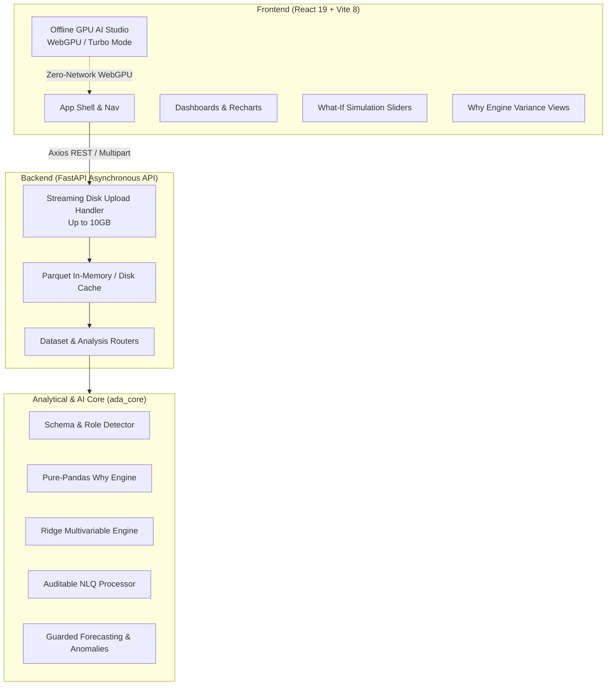

# ⚡ InsightX — Autonomous AI Data Analyst

<p align="center">
  
</p>

<p align="center">
  <strong>Transform raw CSV and Excel data into decision-ready business intelligence, causal variance drivers, interactive what-if simulations, and air-gapped on-device AI insights.</strong>
</p>

<p align="center">
  <a href="#-key-features"></a>
  <a href="#-quick-start"></a>
  <a href="#-architecture"></a>
  <a href="#-privacy--air-gap-guarantee"></a>
</p>

<p align="center">
  
  
  
  
  
  
</p>

---

## 📌 Table of Contents

- [Overview](#-overview)
- [Why InsightX?](#-why-insightx)
- [Key Features](#-key-features)
  - [1. Root Cause "Why Engine"](#1-root-cause-why-engine)
  - [2. Multivariable "What-If" Simulator](#2-multivariable-what-if-simulator)
  - [3. Natural Language "Ask Data" (NLQ)](#3-natural-language-ask-data-nlq)
  - [4. Offline GPU AI Studio (WebGPU)](#4-offline-gpu-ai-studio-webgpu)
  - [5. Automated Visualizations & Profiling](#5-automated-visualizations--profiling)
  - [6. Calibrated Anomalies & Guarded Forecasting](#6-calibrated-anomalies--guarded-forecasting)
- [Architecture & Tech Stack](#-architecture--tech-stack)
- [Project Structure](#-project-structure)
- [Quick Start](#-quick-start)
  - [Prerequisites](#prerequisites)
  - [Backend Setup](#1-backend-fastapi)
  - [Frontend Setup](#2-frontend-react--vite)
- [API Reference](#-api-reference)
- [Privacy & Air-Gap Guarantee](#-privacy--air-gap-guarantee)
- [Supported Formats & Scale](#-supported-formats--scale)
- [Contributing & License](#-contributing--license)

---

## 🌟 Overview

**InsightX** is a next-generation autonomous AI Data Analyst platform built to replace slow, manual spreadsheet crunching and opaque "black-box" LLM analytics. 

Drop in any structured dataset (`.csv`, `.tsv`, `.xlsx`, `.xlsm`, or `.parquet`) up to **10 GB** in size. InsightX instantly parses the schema, identifies business metrics, temporal dimensions, and categorical segments, and delivers:
- **Interactive Multi-dimensional Dashboards** with automatic chart recommendations.
- **Explainable Driver Attribution** via mathematical variance decomposition.
- **Predictive Scenario Simulation** using regularized Ridge regression.
- **Verifiable Natural Language Question Answering** with code execution audit trails.
- **Zero-Latency, Private AI Analysis** accelerated directly on local hardware via WebGPU.

> 💡 **Core Philosophy:** *Every single number, trend, and anomaly flag displays the underlying mathematical calculation. No unverified hallucinations, no blind trust, and no data leaving your machine unless you explicitly choose to.*

---

## 🚀 Why InsightX?

| Traditional BI Tools (Tableau, PowerBI) | Generic LLM Wrappers (Chat with CSV) | **InsightX Platform** |
| :--- | :--- | :--- |
| ❌ Hours of manual dashboard setup & DAX/SQL coding | ❌ Hallucinates calculations; can't handle files > 5MB | ⚡ **Zero setup:** Schema and roles automatically inferred |
| ❌ Static charts without root-cause explanations | ❌ Sends private company rows to external third-party cloud APIs | 🔒 **100% Private:** Streaming disk architecture & local compute |
| ❌ Complex regression setup for scenario modeling | ❌ No deterministic mathematical verification | 🎛️ **Built-in What-If Simulator & Root Cause Why Engine** |
| ❌ High per-seat enterprise licensing costs | ❌ Token limits truncate your datasets | 💻 **Air-gapped WebGPU AI Studio** runs directly in local VRAM |

---

## ✨ Key Features

### 1. Root Cause "Why Engine"
*Stop guessing why a metric changed.* The **Why Engine** mathematically decomposes period-over-period variance across every categorical dimension:
- Identifies the top positive and negative contributors to revenue/volume movements.
- Calculates absolute change, percentage contribution, and weighted swing.
- Displays full calculation ledgers and segment watermarks with zero causal hallucinations.

### 2. Multivariable "What-If" Simulator
*Evaluate business decisions before committing capital.*
- Fits an adaptive **L2-Regularized (Ridge) statistical model** across numeric covariates.
- Provides interactive parameter sliders with dynamic min/max bounds and baseline resets.
- Computes real-time projected outcomes, marginal elasticity, and net delta impact.

### 3. Natural Language "Ask Data" (NLQ)
*Ask business questions in plain English and get auditable answers.*
- **Pure Pandas Execution:** Converts user intent into exact aggregations, filters, and group-bys.
- **Audit Ledger:** Displays the formula, code, and source rows used for every answer.
- **Smart Suggestion Engine:** Proposes relevant business questions based on detected column roles.

### 4. Offline GPU AI Studio (WebGPU)
*Autonomous intelligence running directly inside your browser's VRAM or CPU.*
- **Zero Cloud Latency:** Direct on-device neural acceleration powered by WebGPU.
- **Dual Execution Modes:**
  - `Turbo Mode`: Instant 60 FPS deterministic rule-based narrative engine (0ms lag).
  - `WebGPU Neural Mode`: In-browser LLM inference completely air-gapped from the internet.
- **One-Click Markdown Export:** Export entire analytical dialogues to structured executive reports.

### 5. Automated Visualizations & Profiling
- **Smart Chart Recommendation:** Automatically chooses the optimal chart type (Time-series line, Segment breakdown bar, Movement waterfall, or Heatmap).
- **Data Hygiene Score:** 0–100 health audit examining missing rates, duplicate records, type consistency, and cardinality.
- **Large Dataset Profiling:** Summarizes high-volume datasets safely without UI freezes.

### 6. Calibrated Anomalies & Guarded Forecasting
- **Calibrated Anomaly Radar:** Statistically tuned outlier detection using interquartile bands calibrated to produce less than 1 false positive per 20 analyses.
- **Guarded Baseline Forecasting:** Uses trend extrapolation with automated backtesting. If historical depth is insufficient to beat a naive drift model, it transparently warns the user instead of presenting false confidence.

---

## 🏗️ Architecture & Tech Stack

InsightX adopts a high-performance decoupled architecture designed for speed, security, and scalability:



### Technologies Used

- **Frontend:** React 19, Vite 8, Recharts, Lucide React, Oxlint, Vanilla CSS Design System.
- **Backend:** FastAPI, Uvicorn, Python 3.11+, Pydantic v2.
- **Computation:** Pandas 2.2+, NumPy, PyArrow (Parquet engine), OpenPyXL.
- **Acceleration:** WebGPU API, Canvas Confetti, Marked.js.

---

## 📂 Project Structure

```bash
Insightx/
├── backend/                  # FastAPI Application
│   ├── api/                  # API Route Controllers
│   │   ├── ask.py            # Natural language query endpoints
│   │   ├── dataset.py        # Overview, health, forecast, and chart endpoints
│   │   ├── upload.py         # Streaming disk upload & sample loaders
│   │   ├── whatif.py         # What-If model configuration & prediction
│   │   └── why.py            # Period-over-period variance decomposition
│   ├── services/             # Core business logic services
│   │   ├── analysis_service.py # End-to-end dataset processing orchestration
│   │   ├── nlq_enhancer.py    # Dual-mode natural language engine
│   │   ├── whatif_engine.py   # Regularized regression simulator
│   │   └── why_engine.py      # Mathematical driver attribution
│   ├── main.py               # FastAPI entrypoint & CORS config
│   └── session_store.py      # Fast Parquet session persistence
│
├── frontend/                 # React 19 Web Client
│   ├── src/
│   │   ├── components/       # Reusable UI widgets, Layouts & DropZone
│   │   ├── pages/            # Feature Views (WhyEngine, WhatIf, Overview, etc.)
│   │   │   ├── WhyEngine.jsx       # Driver attribution interface
│   │   │   ├── WhatIf.jsx          # Interactive scenario simulator
│   │   │   ├── OfflineGPUAI.jsx    # WebGPU Studio launcher & diagnostics
│   │   │   ├── AskData.jsx         # Plain-English question console
│   │   │   ├── DataHealth.jsx      # Data hygiene & profiling dashboard
│   │   │   └── Visualizations.jsx  # Dynamic charts & metrics
│   │   ├── services/api.js   # Centralized Axios client
│   │   ├── App.jsx           # Root application container
│   │   └── index.css         # Modern design tokens & glassmorphism
│   ├── package.json          # Node dependencies & scripts
│   └── vite.config.js        # Vite config with backend proxy
│
├── ada_core/                 # Core Statistical & Analytical Computation Engine
│   ├── aggregation.py        # Trend frames & multi-period rollups
│   ├── anomalies.py          # Calibrated statistical outlier detection
│   ├── autovis.py            # Automated chart recommendation algorithms
│   ├── business_insights.py  # Strategic finding generator
│   ├── forecasting.py        # Guarded forecast model & backtester
│   ├── nlq.py                # Audited pandas query parser
│   └── schema.py             # Heuristic column role & type inference
│
├── Dataset/                  # Included Sample Datasets
│   ├── retail_store_sales.csv
│   ├── sample_-_superstore.xls
│   └── synthetic_dataset.csv
│
└── web-showcase/             # Standalone Air-Gapped WebGPU AI Studio
    └── index.html            # Zero-dependency browser-based AI interface
```

---

## ⚡ Quick Start

### Prerequisites
- **Python**: Version `3.11` or higher installed
- **Node.js**: Version `18.0.0` or higher (with `npm`)

---

### 1. Backend (FastAPI)

1. Open a terminal and navigate to the project root:
   ```bash
   cd Insightx
   ```

2. Create and activate a Python virtual environment:
   ```bash
   # Windows
   python -m venv .venv
   .venv\Scripts\activate

   # macOS / Linux
   python3 -m venv .venv
   source .venv/bin/activate
   ```

3. Install required backend dependencies:
   ```bash
   pip install fastapi uvicorn pandas numpy pyarrow openpyxl python-multipart pydantic
   ```

4. Start the FastAPI development server:
   ```bash
   python -m uvicorn backend.main:app --host 127.0.0.1 --port 8000 --reload
   ```
   > 🚀 Backend will be live at: `http://127.0.0.1:8000`  
   > 📖 Interactive Swagger API Docs at: `http://127.0.0.1:8000/docs`

---

### 2. Frontend (React + Vite)

1. Open a second terminal window and navigate to the `frontend/` directory:
   ```bash
   cd Insightx/frontend
   ```

2. Install client dependencies:
   ```bash
   npm install
   ```

3. Launch the Vite development server:
   ```bash
   npm run dev
   ```
   > 🌐 Open your browser and navigate to: `http://localhost:3000`

---

## 📡 API Reference

| Method | Endpoint | Description |
| :--- | :--- | :--- |
| `POST` | `/api/upload` | Upload `.csv`, `.xlsx`, `.xlsm`, `.parquet` (chunked streaming up to 10GB) |
| `GET` | `/api/demo` | Instantly loads the built-in demonstration dataset |
| `GET` | `/api/samples` | Lists available pre-bundled sample datasets |
| `POST` | `/api/sample/{name}` | Loads a specific pre-bundled sample dataset |
| `GET` | `/api/dataset/{id}/overview` | Returns dataset KPIs, summary totals, and column metadata |
| `GET` | `/api/dataset/{id}/quality` | Returns data hygiene score, duplicate count, and missing value rates |
| `GET` | `/api/dataset/{id}/visualizations`| Returns recommended charts, trends, and category breakdowns |
| `GET` | `/api/dataset/{id}/anomalies` | Returns calibrated statistical anomaly alerts |
| `GET` | `/api/dataset/{id}/forecast` | Returns guarded time series predictions with backtest accuracy |
| `GET` | `/api/dataset/{id}/why` | Executes variance decomposition & root-cause attribution |
| `GET` | `/api/dataset/{id}/what-if/config` | Retrieves model features, ranges, and baseline coefficients |
| `POST` | `/api/dataset/{id}/what-if/predict`| Simulates prospective metric changes based on tweaked parameters |
| `POST` | `/api/dataset/{id}/ask` | Processes natural language questions with full calculation audit logs |
| `GET` | `/api/dataset/{id}/download/brief` | Downloads executive brief in structured Markdown format |
| `GET` | `/api/dataset/{id}/download/data` | Downloads cleaned, normalized CSV file |

---

## 🔒 Privacy & Air-Gap Guarantee

InsightX is architected from the ground up for strict enterprise data compliance:

1. **Zero Row Telemetry:** Your raw data records are processed entirely in local memory and disk caches. No rows are ever transmitted to third-party APIs or telemetry trackers.
2. **Deterministic Computation:** Analytical metrics, trends, and what-if simulations are computed with auditable Python code, not stochastic LLM guesses.
3. **Hardware Air-Gap (WebGPU):** The Offline GPU AI Studio runs models inside the browser client sandbox. Disconnecting your internet connection does not interrupt the intelligence pipeline.

---

## 📊 Supported Formats & Scale

- **Supported File Types:** `.csv`, `.tsv`, `.xlsx`, `.xlsm`, `.parquet`
- **Multi-Sheet Handling:** Automatically detects multiple sheets in Excel workbooks and provides a clean sheet picker modal.
- **Upload Scale:** Disk-streamed architecture supports files up to **10 GB**.
- **In-Memory Analytical Cap:** Optimized for rapid sub-second aggregations on up to **500,000+ rows**.

---

## 🤝 Contributing & License

Contributions, feedback, and feature requests are welcome!

1. Fork the repository
2. Create your feature branch (`git checkout -b feature/amazing-feature`)
3. Commit your changes (`git commit -m 'Add amazing feature'`)
4. Push to the branch (`git push origin feature/amazing-feature`)
5. Open a Pull Request

This project is licensed under the [MIT License](LICENSE).

---

<p align="center">
  Built with ❤️ for data analysts, founders, and business leaders who demand <strong>truth over hallucinations</strong>.
</p>
